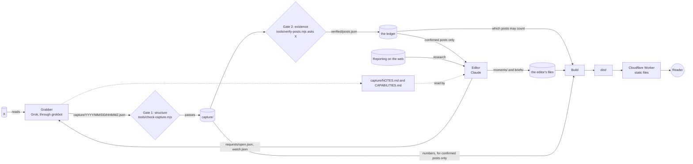

# Architecture

Monitoring the Situation is a static website about what the internet is paying attention to,
with X as its main instrument. This repository is the whole system: it is the handoff between the
two agents that make the site, the record of everything they produced, and the source of the site.

Status of each part is marked **Built** or **Planned**. Nothing marked Planned exists yet.

## The pieces

Every arrow is a real dependency: the node at its head reads what the node at its tail wrote.

| Node | Job | Reads | Writes | How it fails |
|---|---|---|---|---|
| Grabber | Record what is viral on X, and re-read it on a schedule | X, `requests/` | `capture/` | A capture with `run.status` `partial` or `down` and a reason. A missing file means it did not run. |
| Gate 1, structure (**Built**) | Reject a malformed capture | one capture file, ids from earlier captures | PASS or a list of errors | Exit 1. The grabber fixes the file or replaces it with a `down` run. |
| Gate 2, existence (**Built**: `tools/verify-posts.mjs`) | Confirm against X that each post exists and that its author and words match | `capture/`, `moments/` (to know which posts stories cite), X's public oEmbed endpoint | `verified/posts.json`: for each post `ok`, `mismatch`, `missing` or `withheld`, when it was checked, and the run that first recorded it; a count per run is printed | A post that is not `ok` is never published and counts for nothing in any total. First full pass, 2026-10-09: 272 confirmed, 0 missing, 0 mismatched, 2 withheld by X. |
| Editor | Group posts into stories, research them, write every word | confirmed posts, reporting on the web | `moments/`, `briefs/`, `requests/` | A story it cannot stand behind is not written. |
| Build (**Built**: `tools/build.mjs`) | Render the site | `moments/`, `capture/`, `verified/posts.json`, `contract/desks.json`, `site.json` | `dist/` | Refuses to build if a story cites a post that no capture recorded or that Gate 2 has not confirmed. Desk traces and totals use confirmed posts only. `--demo` reads `fixtures/demo` and skips the ledger. |
| Cloudflare (**Built**: `wrangler.jsonc`, `tools/ship.sh`) | Serve `dist/` at situation.seansooch.dev | `dist/` | the public site | The previous version stays live. `tools/ship.sh` refuses a dirty tree, failing tests or a demo build, and compares the live page with the build afterwards. |

Two rules hold the design together:

Status of the grabber's schedule: grokbot reports it running hourly at :58 since 2026-10-09; the
proof is a new file under `capture/` each hour, and a missing hour means it did not run.

1. **Words and numbers come from different hands.** The grabber supplies posts and numbers and
   never writes prose. The editor writes prose and never supplies a post or a number. So an invented
   post and an unsupported sentence are each one party's failure and can be found separately.
2. **Nothing appears until the editor has passed it.** A capture is never shown to a reader
   directly: no post's words, author or link reach a page unless the editor put that post in a
   story. Once it is in a story, its numbers refresh on their own from later captures. The one
   thing that reaches the page without the editor is arithmetic: a desk's trace and its total for
   the day are sums over every post X has confirmed on that desk, including posts flagged as
   showing private people, which are counted and never shown.

## Directory map

| Path | Owner | What it is |
|---|---|---|
| `contract/` | Editor | The grabber's standing orders (`GRABBER.md`), the capture format (`CAPTURE.md`), the desks (`desks.json`), a checked example. **Built.** |
| `tools/check-capture.mjs` | Editor | Gate 1, and the definition of a valid capture. **Built.** |
| `tests/` | Editor | The contract as tests. **Built.** |
| `requests/` | Editor | What the editor wants from the next run: lookups, searches, and the list of posts to keep re-reading. **Built** (format); the grabber starts reading it with its first run. |
| `capture/` | Grabber | One file per run, append only (`YYYY/MM/DD/HHMMZ.json`). Beside them, the grabber's own papers, which the contract asks for and the editor reads: `CAPABILITIES.md` (what X actually returns, and the standing query per desk), `RUNBOOK.md` (its hourly procedure), `SENSORS.md` (accounts it reads), `NOTES.md` (its channel back to the editor), and `handover/` (the old briefing's method and the old feed Worker's source, secrets removed). |
| `contract/KICKOFF.md`, `REPLY-01.md`, `REPLY-02.md` | Editor | The messages Sean pasted to grokbot, kept on record. |
| `wrangler.jsonc`, `tools/ship.sh` | Editor | Where the files are served and the only way they are shipped. **Built.** |
| `fixtures/demo/` | generated | Written by `tools/make-demo.mjs`, ignored by git. |
| `moments/` | Editor | One file per story (`mts.moment/1`): title, standing, what happened, why it is spreading, how each world sees it, what is on the record, the posts it cites by id, sources. **Built.** |
| `verified/posts.json` | Editor | Gate 2's ledger: for each post checked, what X answered and when. **Built.** |
| `site.json` | Editor | The site's name, its pinned post and its statement of purpose. **Built.** |
| `briefs/` | Editor | One file per day: the daily briefing by desk. **Planned.** |
| `site/` | Editor | The stylesheet, the page script and the icon. Page templates live in `tools/build.mjs`. **Built.** |
| `tools/lib/metrics.mjs` | Editor | Arithmetic on readings: magnitude, a story's totals and trend, a desk's trace. **Built.** |
| `tools/make-demo.mjs`, `tools/demo-stories.mjs` | Editor | An invented day in the real file formats, for design work. A build from it is marked on every page and leaves a `DEMO` file so it is never deployed. **Built.** |
| `.github/workflows/check.yml` | Editor | Runs the tests and Gate 1 on every push, and fails a capture commit that touches anything outside `capture/`. **Built.** |

## The desks

The site watches twenty desks in six groups: News (politics, world, defense, justice, disaster),
Money (markets, business, crypto), Science and tech (ai, tech, science, medicine), Culture
(entertainment, music, gaming, ideas), Sports (sports), and Life online (internet, life, offbeat).

`contract/desks.json` is the only list. Each desk has an id, a short code, a scope, its near
misses, its beats, how often the grabber sweeps it, and the smallest post worth taking. Three
readers share the file, so a desk is added, merged or renamed in one place:

- the checker rejects a post or sweep whose desk is not in it, and a beat that is not its desk's;
- the grabber decides which desks are due and what clears the floor from it;
- the site draws its sections, their order and their codes from it (**Built**).

A desk id that has been used in a capture is never renamed or removed, only retired: old captures
still carry it.

## The checks on the grabber

A language model reading X can produce a post that looks right and does not exist. Three checks,
none of which trust the grabber's own word:

- **The id carries its own date.** An X id encodes the millisecond it was created. Gate 1 rejects a
  record whose `created_at` disagrees with its id. A made-up id almost never survives this.
- **X is asked directly.** Gate 2 asks X's public oEmbed endpoint for each post before it is
  published. It answers with the author and text for a real post and 404 for one that does not exist.
  Checked on 2026-10-09: a real post returned its author and text; a random id returned 404.
- **Some lookups have no answer.** The editor may ask the grabber to look up an id that does not
  exist. The right answer is `not_found`. A record returned for one is an invention, caught by the
  same Gate 2.

## The site

One static build, no server and no database. `node tools/build.mjs` writes `dist/`:

- `/` the pulse: the pinned post and the purpose, the record (one trace per desk over 24 hours),
  a picker for the reader's own desks, and the bulletin of stories ranked by magnitude.
- `/story/<id>/` one page per story, `/desk/<id>/` one per desk, `/desks/`, `/about/`.
- `/data/pulse.json` the same numbers for machines.

Purpose, which decides the design: people who read different things come away with different
days (the pinned post). The site puts every desk on one sheet, and where groups describe one
story differently it sets each description beside the post that carries it, then states what
is established.

How a number reaches the page: magnitude is the base ten log of views across a story's posts
at their latest reading; a desk's trace is views gained per hour by the posts the grabber
labelled with that desk, spread over the time between readings. A desk's figure for the day
counts posts written in the last 24 hours. The trace will be drawn from X's hourly post counts
(`volume`) once a week of them is in for every desk (**Planned**).

The reader's own desks are kept in their browser only (`localStorage`); nothing is sent anywhere.
Fonts come from Google Fonts. No other third party is contacted. Every page is `noindex`
(a header and `robots.txt`) until Sean opens the site to search engines.

Not built yet: a daily brief and an archive, scheduled editor passes, traces drawn from `volume`,
click-to-load embeds of posts.

## What this replaces

seansooch.dev/monitor/ is a daily briefing in three views. It reads a feed that grokbot both
gathers and writes, published to a Cloudflare Worker (`feed.seansooch.dev`, source on the agent box).
That page keeps running, unchanged, until this site is live. Then `/monitor/` redirects here and the
Worker is retired. Both of those are separate, later changes and need Sean's go-ahead.

## Third parties

At runtime, one: Google Fonts (the stylesheet and three font families). Nothing else is loaded
from another origin, no page posts data anywhere, and an enforced Content-Security-Policy in
`_headers` holds it to that. A link to a post opens X in a new tab. At build and edit time:
GitHub, X's oEmbed endpoint, Cloudflare.
