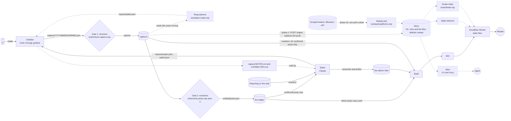

# Architecture

Monitoring the Situation is a static website about what the internet is paying attention to,
with X as its main instrument. This repository is the whole system: it is the handoff between the
two agents that make the site, the record of everything they produced, and the source of the site.

Status of each part is marked **Built** or **Planned**. Nothing marked Planned exists yet. A
part becomes Built when its done test in `PROGRAM.md` has passed, not when its code lands.

## The pieces

Every arrow is a real dependency: the node at its head reads what the node at its tail wrote.
Dashed nodes and arrows are Planned; the phase that builds each is in `PROGRAM.md`.

| Node | Job | Reads | Writes | How it fails |
|---|---|---|---|---|
| Grabber | Record what is viral on X, and re-read it on a schedule | X, `requests/` | `capture/` | A capture with `run.status` `partial` or `down` and a reason. A missing file means it did not run. |
| Gate 1, structure (**Built**) | Reject a malformed capture | one capture file, ids from earlier captures | PASS or a list of errors | Exit 1. The grabber fixes the file or replaces it with a `down` run. |
| Gate 2, existence (**Built**: `tools/verify-posts.mjs`) | Confirm against X that each post exists and that its author and words match | `capture/`, `moments/` (to know which posts stories cite), X's public oEmbed endpoint | `verified/posts.json`: for each post `ok`, `mismatch`, `missing` or `withheld`, when it was checked, and the run that first recorded it; a count per run is printed | A post that is not `ok` is never published and counts for nothing in any total. First full pass, 2026-10-09: 272 confirmed, 0 missing, 0 mismatched, 2 withheld by X. |
| Editor | Group posts into stories, research them, write every word | confirmed posts, reporting on the web | `moments/`, `briefs/`, `requests/` | A story it cannot stand behind is not written. |
| Build (**Built**: `tools/build.mjs`) | Render the site | `moments/`, `capture/`, `verified/posts.json`, `contract/desks.json`, `site.json` | `dist/` | Refuses to build if a story cites a post that no capture recorded or that Gate 2 has not confirmed. Desk traces and totals use confirmed posts only. `--demo` reads `fixtures/demo` and skips the ledger. |
| Cloudflare (**Built**: `wrangler.jsonc`, `tools/ship.sh`) | Serve `dist/` at situation.seansooch.dev | `dist/` | the public site | The previous version stays live. `tools/ship.sh` refuses a dirty tree, failing tests or a demo build, and compares the live page with the build afterwards. |
| Read planner (**Planned** until phase 0's done test passes; code landed 2026-10-28: `tools/plan-reads.mjs`, `tools/lib/plan.mjs`) | Turn the day's remaining budget into the next run's read list, in the contract's order | the last three days of captures, `requests/watch.json` and `open.json`, `contract/desks.json`, `contract/budget.json` | `requests/plan.json` (`contract/PLAN.md`): reads in order, a budget line each | A day that cannot afford the list is cut in `budget.json`'s order, never the re-read list or the counts; a plan still over budget says so. A missing or stale plan sends the grabber back to the standing orders, which it says in `run.reason`. A planner error never stops the refresh. |
| Budget report (**Planned** until it passes; code landed 2026-10-28: `tools/budget-report.mjs`, `tools/lib/budget.mjs`) | Say, for each UTC day, whether the grabber did what the contract asks | `capture/`, `contract/desks.json`, `contract/budget.json`, `moments/`, `pulse/current.json`, the ledger | one verdict line a day and what fell short; exit 1 on any failing full day | A run short for our own reasons, reads outside 600 to 850, a desk under its cadence, counts over four hours apart, or a story-cited post left off a re-read list, each fails the day by name. |
| Store (**Planned** until phase 1's done test passes; code landed 2026-10-28: `worker/index.mjs`, `worker/schema.sql`) | Hold the record where a deletion can be honoured within 24 hours | `POST /ingest` from the grabber (mirrored by `tools/refresh.sh` until then); X's oEmbed endpoint for the hourly sweep | D1: a row per run, post, observation, sweep, count, trend, context and answer, a gzipped copy of each capture, the `checks` ledger, a sweep log; the `/api/*` reads | A capture failing Gate 1 is refused with its errors (`422`); a different file for a run already held is refused (`409`). A post X answers 404 for loses its words from its row and from every file that holds it, or the nightly store test fails. |
| Weekly poll (**Planned**, phase 1b: `tools/poll-platforms.mjs`) | Once a week, the week's stories on six other platforms, under 100 ScrapeCreators credits, never re-read | the week's top stories and the medicine desk's claims; ScrapeCreators; Bluesky's public API | rows in the store with `source`, the credit count, `/week/` | Over 100 credits the poll stops and says so. A platform with no existence check is shown "as read on" the poll's date. A scraper going dark costs the Sunday page, never the pulse. |
| Wire (**Planned**, phase 2) | Answer agents with ids, numbers and the editor's words | the store, the editor's files | HTTP and MCP responses, an aggregated query log, `/status` | Never a post's text; a test walks every endpoint. Over the limit: `429`. |
| Spike detector (**Planned**, phase 3) | Say when a desk is above its normal hour of the week | `volume` in the store | `signals/spikes.json`, an alert, the desk card | Under two weeks of counts: no number, and the card says so. |
| Divide Index (**Planned**, phase 5: `tools/divide.mjs`) | One number a day for how little the day's audiences overlap | the store's `sides` sweeps | the index per desk and day, the bridging posts | Under the floor of posts or accounts the number is withheld and n is shown. |

Two rules hold the design together:

Status of the grabber's schedule: grokbot reports it running hourly at :58 since 2026-10-09; the
proof is a new file under `capture/` each hour, and a missing hour means it did not run.

1. **Words and numbers come from different hands.** The grabber supplies posts and numbers and
   never writes prose. The editor writes prose and never supplies a post or a number. So an invented
   post and an unsupported sentence are each one party's failure and can be found separately.
2. **Nothing appears until the editor has passed it.** This holds for a single post on the
   pulse exactly as for a story, and the build adds a stop of its own: it refuses to render a
   post the grabber flagged as showing a private person or a minor, or as sexual or graphic,
   whatever the editor wrote.
3. **No one account fills the pulse.** An account holds one place: of the posts the editor
   passed, the build keeps each account's most viewed and prints the ones it held back
   (`placesPerAccount` in `tools/lib/metrics.mjs`, `PULSE_PER_ACCOUNT` in the build). The rule
   is applied to each list a reader is shown, the front page and each desk's own, so a post
   held off the front still stands on its desk. The rule
   is in the build and not only in the editor's instructions because a post's rank changes
   every hour and the no-model refresh rebuilds the page without an editor. Upstream, the
   grabber keeps at most three new posts from one account in a run (`contract/GRABBER.md`),
   so one account cannot use up a capture either.

   In detail: A capture is never shown to a reader
   directly: no post's words, author or link reach a page unless the editor put that post in a
   story. Once it is in a story, its numbers refresh on their own from later captures. The one
   thing that reaches the page without the editor is arithmetic: a desk's trace and its total for
   the day are sums over every post X has confirmed on that desk, including posts flagged as
   showing private people, which are counted and never shown.

## The program

`PROGRAM.md` is the plan for what comes next: seven phases, from spending the whole read budget
to charging for the wire, each with a done test Sean can read in twenty minutes. Three
constraints shape every part of it and are repeated here because they shape the architecture:

- **X is read only through grokbot's existing access.** 1,000 reads a day, 30 a minute, shared
  with the daily briefing; the contract says stay under 850. The grabber spent about 480 a day in
  the week to 2026-10-27 and ended days with about 500 unused. Every phase states its cost in
  reads, and the planner (phase 0) is how the budget is spent on purpose.
- **grokbot stays the grabber.** Nothing replaces it. What moves is the decision of which reads
  to make: from Grok's own cut order to `requests/plan.json`, written by a tool and readable by
  Sean.
- **The editor runs on the subscription.** About 24 passes a day at $11 to $13 a day at API
  rates, logged by grokbot in `capture/EDITOR-RUNS.md`, billed as usage of Sean's Claude plan.
  Cash cost today is the Cloudflare plan.
- **X is the instrument; the other platforms are a weekly cross-section.** TikTok, Instagram,
  YouTube, Reddit, Threads and Bluesky are polled once a week (phase 1b) through ScrapeCreators
  credits Sean already holds, under 100 a week, never re-read. Measured 2026-10-27: YouTube's
  oEmbed and Bluesky's embed endpoint confirm a post for free; TikTok's oEmbed answers 200 for
  any id; Reddit's needs the official API; Instagram's and Threads' need a Meta token.

What leaves the system is bounded by X's developer policy: ids and links may be passed on, copies
of posts may not, and a post deleted on X must be gone from here within 24 hours. So the wire
never returns a post's words, the store (phase 1) purges on deletion, and what is sold is the
editor's words and the engine's numbers.

## Directory map

| Path | Owner | What it is |
|---|---|---|
| `PROGRAM.md` | Editor | The charter: seven phases with a done test each, the constraints, what is sold and never sold, the open decisions, a weekly log. **Built** as a document; each phase is Planned until its test passes. |
| `contract/` | Editor | The grabber's standing orders (`GRABBER.md`), the capture format (`CAPTURE.md`), the desks (`desks.json`), the read budget in numbers (`budget.json`, the one place a number is changed), the plan format (`PLAN.md`), a checked example. **Built.** |
| `tools/check-capture.mjs`, `tools/lib/capture-check.mjs` | Editor | Gate 1: the definition of a valid capture as a pure function (`lib/`, which the Worker's `/ingest` runs too) and its command line. **Built.** |
| `tools/verify-posts.mjs`, `tools/lib/gate2.mjs` | Editor | Gate 2: the comparison with what X says as pure functions (`lib/`, which the Worker's sweep runs too) and the command line that keeps `verified/posts.json`. **Built.** |
| `worker/` | Editor | The Worker script (`index.mjs`: the store's routes and the deletion sweep; everything else falls through to the static files) and the store's schema (`schema.sql`, applied with `wrangler d1 execute`). Code landed 2026-10-28; **Planned** until phase 1's test passes. |
| `tools/ingest.mjs`, `tools/lib/store.mjs`, `tools/lib/store-rows.mjs` | Editor | Delivery of capture files to the store, the store's client (token from `MTS_TOKEN` or the git-ignored `store.local.token`), and the pure mapping of a capture to rows and of a record to its purged form. Code landed 2026-10-28. |
| `tests/` | Editor | The contract as tests. **Built.** |
| `requests/` | Editor | What the editor wants from the next run: lookups, searches, the list of posts to keep re-reading, and `plan.json`, the next run's read list with a budget line each, written by `tools/plan-reads.mjs` after every capture and every editor pass, never by hand. **Built**; the grabber reads all three every run. |
| `capture/` | Grabber | One file per run, append only (`YYYY/MM/DD/HHMMZ.json`), until phase 1 moves delivery to the store. Beside them, the grabber's own papers, which the contract asks for and the editor reads: `CAPABILITIES.md` (what X actually returns, and the standing query per desk), `RUNBOOK.md` (its hourly procedure), `SENSORS.md` (accounts it reads), `NOTES.md` (its channel back to the editor), `EDITOR-RUNS.md` (every editor pass with its duration and cost at API rates), `RANKING.md` (its reading of X's open-sourced ranking code), `TALLY.json` (origins seen in the global streams, by run), and `handover/` (the old briefing's method and the old feed Worker's source, secrets removed). |
| `contract/KICKOFF.md`, `REPLY-01.md` to `REPLY-05.md` | Editor | The messages Sean pasted to grokbot, kept on record. `REPLY-05.md` (2026-10-27) carries phase 0's contract changes and two questions for later phases. |
| `tools/plan-reads.mjs`, `tools/budget-report.mjs`, `tools/lib/plan.mjs`, `tools/lib/budget.mjs` | Editor | The read planner and the day's report that is phase 0's done test, with the arithmetic in `lib/` and tests in `tests/plan.test.mjs` and `tests/budget.test.mjs`. Code landed 2026-10-28; **Planned** until the test passes. |
| `tools/poll-platforms.mjs` | Editor | The Sunday poll of the other six platforms (phase 1b), run by a Worker cron with the ScrapeCreators key as a Worker secret. **Planned.** |
| `signals/`, `live/`, `METHOD.md`, `health/` | Editor | Spikes (phase 3), crisis timelines (phase 4), the Divide Index's method (phase 5), the health edition (phase 6). **Planned.** |
| `contract/EDITOR.md`, `EDITOR-BRIEF-PULSE.md`, `EDITOR-BRIEF.md` | Editor | The procedure, and the two word-for-word briefs (pulse pass, story pass). **Built.** |
| `editor/LOG.md` | Editor | One entry per pass: what was read, what X confirmed, what was added, updated and left out. **Built.** |
| `wrangler.jsonc`, `tools/ship.sh`, `tools/refresh.sh`, `tools/audit-live.mjs` | Editor | Where the files are served, the only way they are shipped, the hourly no-model refresh, and the comparison of live with built. **Built.** |
| `fixtures/demo/` | generated | Written by `tools/make-demo.mjs`, ignored by git. |
| `pulse/current.json` | Editor | Internet Pulse (`mts.pulse/1`): the posts shown on the front page, each with a desk and the editor's line. Rewritten every pulse pass. **Built.** |
| `moments/` | Editor | One file per story (`mts.moment/1`): title, standing, what happened, why it is spreading, how each world sees it, what is on the record, the posts it cites by id, sources. **Built.** |
| `verified/posts.json` | Editor | Gate 2's ledger: for each post checked, what X answered and when. **Built.** |
| `site.json` | Editor | The site's name, its pinned post and its statement of purpose. **Built.** |
| `briefs/` | Editor | One file per day: the daily briefing by desk. **Planned.** |
| `site/` | Editor | The stylesheet, the page script and the icon. Page templates live in `tools/build.mjs`. **Built.** |
| `tools/lib/metrics.mjs` | Editor | Arithmetic on readings: magnitude, a story's totals and trend, a desk's trace. **Built.** |
| `tools/lib/clock.mjs` | Editor | The site's clock: turns a stored UTC instant into the Eastern time a reader sees. The only place a time zone is named. **Built.** |
| `tools/lib/files.mjs` | Editor | The one directory walk, used by the build, Gate 1 and Gate 2: regular files only, never a symlink (the grabber's scratch has held links that loop on a case-insensitive disk). **Built.** |
| `tools/make-demo.mjs`, `tools/demo-stories.mjs` | Editor | An invented day in the real file formats, for design work. A build from it is marked on every page and leaves a `DEMO` file so it is never deployed. **Built.** |
| `.github/workflows/check.yml` | Editor | Runs the tests and Gate 1 on every push, and fails a capture commit that touches anything outside `capture/`. **Built.** |

## Who runs when

- **The grabber** runs hourly on grokbot's scheduler and pushes one capture.
- **A pulse pass** is a Claude agent that grokbot's routine starts after each hourly capture
  (**Built**: running hourly; each pass is logged with its duration and its cost at API rates in
  `capture/EDITOR-RUNS.md`, about 24 a day at $11 to $13 a day in the week to 2026-10-27).
  Brief: `contract/EDITOR-BRIEF-PULSE.md`, passed word for word. It checks new posts with X,
  rewrites `pulse/current.json`, and ships.
- **A story pass** runs four times a day in place of the pulse pass (brief:
  `contract/EDITOR-BRIEF.md`). It does the pulse too, then researches and writes stories.
- **`tools/refresh.sh`** runs after every capture and is the fallback when a pass fails or is
  skipped. No model: it delivers any capture the store does not yet hold, asks X about posts not
  yet checked, writes the next run's plan, commits the ledger and the plan, and ships (**Built**).
- **The Worker's cron** runs the deletion sweep on the hour (`worker/index.mjs`; code landed
  2026-10-28).
- For every pass the procedure is `contract/EDITOR.md`, which the agent reads from the repository
  itself. grokbot runs the clock and supplies no instruction about content. A pass may write only
  `pulse/`, `moments/`, `requests/`, `verified/posts.json` and `editor/LOG.md`; CI fails a
  `pulse:` or `bulletin:` commit that touches anything else. `editor/LOG.md` is the editor's
  memory from one pass to the next. A pass ships with `tools/ship.sh`.
- **The main editor** (a Claude session with Sean) owns the contract, the tools and the site,
  and is the only one who changes them.

## The desks

The site watches nineteen desks in six groups: News (politics, world, defense, justice,
disaster), Money (markets, business), Science and tech (ai, tech, science, medicine), Culture
(entertainment, music, gaming, ideas), Sports (sports), and Life online (internet, life, offbeat).

`contract/desks.json` is the only list. Each desk has an id, a short code, a scope, its near
misses, its beats, how often the grabber sweeps it, and the smallest post worth taking. Three
readers share the file, so a desk is added or retired in one place:

- the checker rejects a post or sweep whose desk is not in it, and a beat that is not its desk's;
- the grabber decides which desks are due and what clears the floor from it;
- the site draws its sections, their order and their codes from it (**Built**).

A desk id that has been used in a capture is never renamed or removed, only retired: old captures
still carry it. Retiring is moving the desk from `desks` to `retired` in the same file with
`retired_at`, the time it stopped, and `instead`, what happens to its subject now. `desks` is
therefore always the list watched now, and a reader that knows nothing about retirement gets
the right answer: the grabber stops sweeping it and the site stops drawing it (no card, no page,
no total; the pages take the number of desks from the list). Only the checker reads `retired`:
it accepts the id in a capture started before `retired_at`, with its old beats, and refuses it
in any capture started after. A retired id or code is never given to a new desk. The crypto
desk was retired on 2026-10-11 (DECISIONS.md).

## The checks on the grabber

A language model reading X can produce a post that looks right and does not exist. Three checks,
none of which trust the grabber's own word:

- **The id carries its own date.** An X id encodes the millisecond it was created. Gate 1 rejects a
  record whose `created_at` disagrees with its id. A made-up id almost never survives this.
- **X is asked directly.** Gate 2 asks X's public oEmbed endpoint for each post before it is
  published. It answers with the author and text for a real post and 404 for one that does not exist.
  Checked on 2026-10-09: a real post returned its author and text; a random id returned 404.
- **Some lookups have no answer.** The editor may ask the grabber to look up an id that does not
  exist. The right answer is `not_found`. A record returned for one is an invention, caught by the
  same Gate 2.

## The site

One static build, no server and no database, until phase 1 of `PROGRAM.md` moves the record to a
store; the pages stay as they are. `node tools/build.mjs` writes `dist/`:

- `/` the nameplate with the site's line and the pinned post; the largest post on the pulse on
  its own; a card per desk (24 bars for the last 24 hours) that is also the switch for the
  reader's own desks; then **Internet Pulse**: the rest of `pulse/current.json`, each under the
  editor's line, in one list ranked by views, one place to an account; then the researched
  stories, a line each.
- `/stories/` the researched stories of the last 48 hours.
- `/story/<id>/` one page per story, `/desk/<id>/` one per desk, `/desks/`, `/about/`, and
  `/archive/` for stories that began more than 48 hours ago (they leave the bulletin and keep
  their page).
- `/data/pulse.json` the same numbers for machines.

Purpose, which decides the design: people who read different things come away with different
days (the pinned post). The site puts every desk on one sheet, and where groups describe one
story differently it sets each description beside the post that carries it, then states what
is established.

How a number reaches the page: magnitude is the base ten log of views across a story's posts
at their latest reading; a desk's 24 bars are views gained per hour by the posts the grabber
labelled with that desk, spread over the time between readings. A desk's figure for the day
counts posts written in the last 24 hours. The bars will be drawn from X's hourly post counts
(`volume`) once a week of them is in for every desk (**Planned**).

How the page is drawn (edition 2, see DECISIONS.md): size carries magnitude. The pulse list is
one `<ol class="pg">` whose items each carry everything any size shows; `site/styles.css` sets
the first three large, the next six a step down and the rest as a line each, by position. So
`site/app.js` sorts by moving the items and never redraws one. `tests/build.test.mjs` pins the
two things that rests on: the list's only children are the items, and the page script reaches
for nothing the pages lack.

Every time on a page is Eastern time, labelled ET (`tools/lib/clock.mjs`). Captures, ids, file names
and each `datetime` attribute stay in UTC.

The reader's own desks are kept in their browser only (`localStorage`); nothing is sent anywhere.
Fonts come from Google Fonts. No other third party is contacted. Every page is `noindex`
(a header and `robots.txt`) until Sean opens the site to search engines.

Not built yet: a daily brief, bars drawn from `volume`, click-to-load embeds of posts, a dark
variant of the page. The program's phases (the planner, the store, the wire, spikes, crisis mode,
the Divide Index, the two editions) are listed in `PROGRAM.md` and not repeated here.

## What this replaced

seansooch.dev/monitor/ was a daily briefing in three views, reading a feed that grokbot both gathered and
wrote. Those pages were removed on 2026-10-09: every address they had now answers with a 301 to this site,
and this site is listed on the seansooch.dev home pages as an app, with a live reachability probe. The feed's
Worker (`feed.seansooch.dev`) and grokbot's 7:03 AM briefing still exist and nothing reads them; retiring
them is Sean's decision.

## Third parties

At runtime, two: Google Fonts (the stylesheet and one font family), and Cloudflare's web
analytics beacon, which Cloudflare adds to every HTML page on the seansooch.dev zone and which
counts visits without cookies. Nothing else is loaded from another origin, and an enforced
Content-Security-Policy in `_headers` holds it to that. Cloudflare also adds an inline bot-check
script to each page; the policy blocks it, which shows as one console message and changes nothing
a reader sees. `tools/audit-live.mjs` compares every live file with the build after removing
those two additions. A link to a post opens X in a new tab. At build and edit time:
GitHub, X's oEmbed endpoint, Cloudflare.
