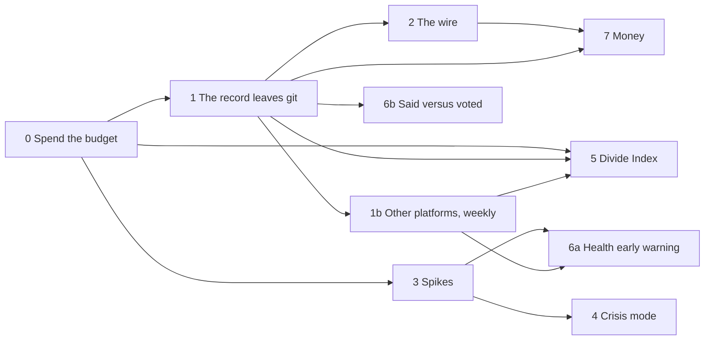

# The program

*Charter, written 2026-10-27. The plan for turning Monitoring the Situation from a site into a
wire. ARCHITECTURE.md says what exists; this file says what is coming, in what order, and what
"done" means for each step. DECISIONS.md holds the reasoning behind every choice made here.*

## What this is

Monitoring the Situation already does something unusual every hour: one model reads what is
viral on X and records it word for word; a checker asks X whether each post exists; a second
model writes sourced stories and never supplies a post or a number; a build refuses to render
anything the checker has not confirmed. Eighteen days in (2026-10-09 to 2026-10-27) that has
produced 376 captures, 11,633 posts checked against X (11,501 confirmed, 57 mismatched, 3
missing, 72 withheld by X), 90 researched stories, and a pulse rewritten 24 times a day.

The program builds on that engine in seven phases, in this order:

0. **Spend the budget.** The grabber uses half the X reads it is allowed. Use them all.
1. **The record leaves git.** Captures go to a store that can honour a deletion within 24 hours.
   - **1b. The other platforms, once a week.** TikTok, Instagram, YouTube, Reddit, Threads and
     Bluesky, polled on Sundays for the week's stories, under 100 ScrapeCreators credits.
2. **The wire.** A public API and an MCP server, so any AI agent can ask what is happening.
3. **Spikes.** Each desk learns its normal hour and says when it is above it.
4. **Crisis mode.** When a desk spikes far past normal, the engine turns to it.
5. **The Divide Index.** One number a day for how far apart the worlds are, with the method published first.
6. **Two editions on the platform.** Health early warning, and said versus voted.
7. **Money.** Free for agents with attribution; paid for the costly parts; plans for organizations.

Health and said-versus-voted are not tracks of their own. They are the first two customers of the
platform the other phases build, each with its own audience and its own liability, and they are
built as editions of it.

## The constraints

These are fixed. A phase that needs one of them relaxed is redesigned, not the constraint.

1. **No paid X API.** X is read through grokbot's existing access and nothing else. The budget is
   1,000 reads a day per user, 30 a minute, shared with the 7:03 AM daily briefing; the contract
   says stay under 850. The grabber has been spending about 480 a day (2026-10-21 to 2026-10-27),
   ending days with roughly 500 unused. The budget is the design constraint of the whole program:
   every phase states what it costs in reads.
2. **grokbot is the grabber.** Grok, through grokbot, reads X and writes captures. Nothing in
   this program replaces it. What changes is who decides which reads to make: today Grok decides
   its own cut order; from phase 0 the editor's tools plan the hour and Grok executes the plan.
3. **The editor runs on the subscription.** The 24 daily passes cost $11 to $13 a day at API
   rates, as grokbot logs them in `capture/EDITOR-RUNS.md`, and are billed as usage of Sean's
   Claude subscription, not as dollars. Cash cost today is the Cloudflare plan and nothing else.
   A phase that raises editor usage says by how much, and the practical ceiling is the
   subscription's limits, the same shape as the X budget.
4. **Words and numbers come from different hands, and nothing appears unreviewed.** The two
   rules in ARCHITECTURE.md hold for every new surface: the wire, the timelines, the index, the
   health sheet. A number a tool computes is published with its inputs; a sentence is the editor's.
5. **X's rules on what leaves the system.** X's developer policy allows passing post ids to third
   parties (1,500,000 a month), not copies of posts, and requires stored content to be deleted or
   modified within 24 hours of its deletion or modification on X. So: the site may display a post
   (its own public display, kept current); the wire never returns a post's words; the store honours
   deletions; and no X content is used to train a model. What the program sells is the editor's
   words, the engine's numbers, ids and links.
6. **The site keeps shipping.** Every phase lands without a day of the hourly pulse missed.
   `tools/ship.sh` stays the only way to ship.

## What is sold and what is never sold

| Sold or given away | Never |
|---|---|
| The editor's lines and stories | The words of a post |
| Scores, indices, baselines, alerts, timelines | Media from a post |
| Post ids, authors as handles, links to X | Anything about a post X no longer returns, beyond its id and its numbers |
| Hourly counts per desk | Per-caller query logs |
| The method behind every number | X content as training data |

## The phases

Each phase has a goal, the work, who does it, what it costs in reads and passes, and a **done
test**: something Sean can read or run in under twenty minutes that says whether the phase is
finished. Nothing is marked **Built** in ARCHITECTURE.md until its done test has passed, and the
done test becomes a test in `tests/` or a tool that prints PASS or FAIL.

### Phase 0: Spend the budget

**Goal.** Every desk swept at its cadence, every watched post re-read as often as it is moving,
hourly counts for all nineteen desks, inside the free budget.

**What the captures show (2026-10-10 to 2026-10-27).** Every one of the last 24 runs has
`run.status` `partial`. Runs spend 18 to 23 reads against a daytime allowance of 42. Fifteen of
nineteen desks have been skipped since 2026-10-10 with the reason "non-hourly desk skipped after
cut order". The re-read list stops at 400 posts and leaves out 70 to 95 a run, among them up to 24
posts cited in stories. `volume` is absent from most runs. None of this is X refusing: no run
reports a 429.

**Work.**

- `contract/GRABBER.md`: the re-read line becomes up to 800 posts (eight reads) when the day has
  room, with a post that has gone flat (under 2 percent gained across its last six readings)
  re-read every sixth run instead of every run; `volume` covers five desks a run in a fixed
  rotation, so every desk every four hours (120 reads a day, and no desk's week of counts is more
  than four hours old); a daytime run that
  spends under 30 reads while desks are due is a failure, not thrift; `run.status` is `ok` only
  when every due desk was swept. Done in this commit.
- `contract/REPLY-05.md`: the message Sean pastes to grokbot, saying the above and asking two
  questions (below). Done in this commit.
- `tools/plan-reads.mjs` (built 2026-10-28; `tools/lib/plan.mjs`, `tests/plan.test.mjs`, format
  in `contract/PLAN.md`, numbers in `contract/budget.json`): the read planner. After every
  capture (`tools/refresh.sh`) and every editor pass, from the last three days of captures,
  `requests/watch.json`, `open.json` and `contract/desks.json`, it writes `requests/plan.json`:
  the ordered list of reads for the next run with a budget line for each (re-reads by id, in
  batches of 100; desks due; the five stalest desks' counts; unanswered requests; discovery),
  totalled against the reads left in the UTC day and the runs left in it, and cut in the
  contract's order when the day is short. The grabber executes the plan and records what it did.
  The cut order moved from Grok's judgement to a tool Sean can read.
- `tools/budget-report.mjs` (built 2026-10-28; `tools/lib/budget.mjs`, `tests/budget.test.mjs`):
  prints, for each day, the verdict and what fell short: runs by status, reads spent, each desk's
  sweeps against its cadence, each desk's longest gap between counts, and any story-cited post a
  run's re-read list left out. This is the done test. Over 2026-10-21 to 2026-10-27 it reads
  0 of 7 days pass: reads 462 to 488, 4 of 19 desks at cadence, counts for none.
- `run.reads`, `run.reads_left` and `run.plan` in every capture (`contract/CAPTURE.md`): the
  budget is a number in the record. The checker warns when they are missing and refuses the file
  from 2026-11-04.
- The 7:03 AM briefing shares the budget and nothing reads it. Retiring it is Sean's decision and
  grokbot's to do. If it goes, the contract's ceiling moves from 850 to 900.

**Who.** Main editor (contract, planner, report). grokbot (executes; answers the two questions).
Sean (pastes the reply; decides the briefing).

**Cost.** Reads: 600 to 850 a day, from about 480. Passes: unchanged.

**Done test.** `node tools/budget-report.mjs --days 7` prints PASS for seven consecutive days:
every run `ok`, or `partial` only for a reason on X's side; every desk swept at least at its
cadence (hourly desks 24 times a day, two-hour desks 12, four-hour desks 6); reads between 600 and
850 each day; counts for every desk at least every four hours; no story-cited post left off the
re-read list.

### Phase 1: The record leaves git

**Goal.** Captures live in a store that can drop a deleted post within 24 hours, and git holds
the contract, the tools, the editor's files and the site, not the data.

**Why now.** The pulse already honours deletions (a MadridXtra post came back Not Found on
2026-10-27 and the editor swapped it out within the hour). Git does not: every capture's text
stays in its history forever. That is tolerable for a private repository with no readers; it is
not tolerable the day a third party reads the record through the wire.

**Work.**

- A Worker route, `POST /ingest` (built 2026-10-28: `worker/index.mjs`, `worker/schema.sql`),
  that takes one capture from the grabber with a bearer token, runs Gate 1 (the same checker,
  now the pure `tools/lib/capture-check.mjs`), and writes its rows (runs, posts, observations,
  sweeps, counts, trends, context, answers) to D1 beside a gzipped copy of the file itself. R2 is
  not enabled on the account, and at this size (a capture gzips to about 60 KB) D1 alone is the
  store. `tools/ingest.mjs` delivers files; `tools/refresh.sh` mirrors every capture pushed to
  git until the grabber delivers there itself. The grabber's delivery changes from a git push to
  a POST at the cutover; `capture/` in git stops growing then.
- The historical captures are imported into the store first, so nothing is lost; then git history
  is rewritten to drop `capture/*.json`, with grokbot recloning. This is the one force-push in the
  program and Sean approves it at the cutover.
- A deletion sweep, hourly, as the Worker's cron (built 2026-10-28): up to 150 posts a sweep,
  those X last returned as `unavailable` first and then the posts checked longest ago (every post
  again within about three days); Gate 2 (`tools/lib/gate2.mjs`) asks X's oEmbed endpoint; a 404
  purges the post's words, author name, media descriptions and link from its row and from every
  stored capture file that holds it, keeping its id and its numbers, up to five purges a sweep.
  The store's `checks` table is the ledger for this; `verified/posts.json` stays the editor's
  until the readers switch.
- `tools/build.mjs`, `verify-posts.mjs` and `metrics.mjs` read from the store (through a small
  read API on the Worker, bearer token, which phase 2 opens up) instead of `capture/`. The site's
  pages do not change.
- `contract/CAPTURE.md` and `GRABBER.md` Delivery sections describe the POST. `.github/workflows/check.yml`
  loses the `capture:` commit rule.

**Who.** Main editor. grokbot (changes delivery; reclones). Sean (approves the history rewrite).

**Cost.** Reads: none. oEmbed is not metered. Cloudflare: D1 is inside the free plan at this size
(about 1,600 rows and 60 KB a capture, 40,000 rows a day against a free limit of 100,000; the
one-time import of the history is more than a day's free writes and is paced or needs the $5
plan). The Worker's CPU limit on the free plan may bind on `/ingest`; the smoke test says.

**Done test.** Three checks, run nightly as `tests/store.test.mjs`: (1) every post the ledger marks
`missing` has no words, author or link anywhere in D1 or git HEAD, and the newest `missing`
was purged within 24 hours of the check that found it; (2) `git grep '"text":' HEAD -- capture`
returns nothing; (3) a build from the store, audited with `tools/audit-live.mjs`, matches the live
site page for page.

### Phase 1b: The other platforms, once a week

**Goal.** Once a week, the week's stories as they ran on TikTok, Instagram, YouTube, Reddit,
Threads and Bluesky: a cross-section beside X's hourly record, for under 100 ScrapeCreators
credits.

**The decision (DECISIONS.md, 2026-10-27).** X drives the pulse and the stories. The other
platforms are polled once a week and never re-read, so there is no second time series to keep
honest and the program's cost base does not move: Sean already holds ScrapeCreators credits, and
one poll a week is a few hundred credits a month.

**Work.**

- `tools/poll-platforms.mjs`, run by a Worker cron on Sunday at 06:00 UTC once the store exists.
  The key is a Worker secret Sean sets himself (`wrangler secret put`); it is never in the
  repository. For each of the week's ten biggest X stories: one keyword search per platform
  (TikTok, Instagram, YouTube, Reddit and Threads through ScrapeCreators; Bluesky through its own
  public API, which needs no key), keeping the largest results with their counts. Three trending
  feeds (TikTok, YouTube Shorts, Instagram Reels) for what went big elsewhere that X did not
  carry. For the medicine desk: one search per health claim the week's sheet will cover, on
  TikTok and Instagram. Transcripts for the videos the editor will write about, up to ten. The
  credits spent are written into the poll's own record. Budget: 100 a week; over it, the poll
  stops and says so.
- Each platform's existence check, measured when built and written into ARCHITECTURE.md.
  Measured 2026-10-27: YouTube's oEmbed answers 200 with the title for a real video and 400 for
  a fake one; Bluesky's embed endpoint answers 404 for a fake post; TikTok's oEmbed answers 200
  for any id, so TikTok needs another check; Reddit's blocks unauthenticated calls and needs the
  official API; Instagram's and Threads' need a Meta token. A platform with no working check
  shows its posts as links with their numbers "as read on" the poll's date, and the page says so.
- `/week/`: the Sunday page. For each of the week's top stories, the largest post about it on
  each platform, by id, link and numbers, under one editor's line on how that platform's version
  differed; then what went big elsewhere. The words are the editor's; no post's text.
- The poll's rows carry `source` like everything else in the store, so phase 5 can compare
  platforms and phase 6a's sheet can cite them.

**Who.** Main editor (the tool, the page). Sean (sets the secret). The weekly story pass writes
the page.

**Cost.** Credits: under 100 a week. Reads on X: none. Passes: one story pass a week.

**Done test.** `tests/platforms.test.mjs`: four consecutive weekly polls in the store, each with
its credit count under 100; every post shown on `/week/` from a platform with a check was
confirmed by it, and every one from a platform without a check is marked "as read on" its date;
no `text` field anywhere on the page or in the wire's `/v1/week`.

### Phase 2: The wire

**Goal.** Any AI agent can ask the engine what is happening and get the same answer the site
gives, with ids, numbers and the editor's words, never a post's text.

**Work.**

- `GET /v1/pulse`, `/v1/desk/{id}`, `/v1/stories`, `/v1/story/{id}`, `/v1/volume/{desk}`, and
  `/v1/check/{post id}`: does this post exist on X, and do the words going around match it
  (`ok`, `mismatch`, `missing`, `withheld`, from Gate 2, with no text in the answer).
- An MCP server at `/mcp` with one tool per endpoint, built on Cloudflare's Agents SDK.
- Keys: anonymous callers get a low rate limit; a free key gets more; every response carries the
  attribution line and the terms link. A `402` path exists on one endpoint from the start, priced
  at zero, so phase 7 is a price change and not a build.
- A query log aggregated by tool, desk and hour, with no key or caller in the aggregate. This is
  the first new signal the wire produces: what the machines are asking.
- `/status`: last capture, last pass, reads spent today, store size, deletion sweep's last run,
  calls today. The page Sean reads on Sunday.

**Who.** Main editor.

**Cost.** Reads: none. Passes: none. Cloudflare: inside the plan until calls are in the millions.

**Done test.** `tests/wire.test.mjs`: (1) a fresh Claude session given only the MCP URL answers
"what is viral on the medicine desk right now" with the same ids and numbers `/desk/medicine/`
shows at that minute; (2) no response from any endpoint contains a post's text (the test walks
every endpoint and asserts no `text` field); (3) the rate limit answers `429`, the priced endpoint
answers a well-formed `402` at price zero, and `/status` shows the day's calls.

### Phase 3: Spikes

**Goal.** Each desk knows its normal count for this hour of this weekday and says, on the site
and to Sean's phone, when it is well above it.

**Work.**

- Baselines from `volume`: for each desk, the median count for each hour of the week over the
  last four weeks (two weeks to start, with the confidence shown). Phase 0 makes the counts
  complete; the baselines accrue from the day it ships.
- A spike is a last full hour at three times its baseline or more, above a floor so a quiet desk
  cannot spike on noise. The desk card shows "above normal, 4x" with the three largest posts.
- An alert to Sean (iMessage, through the channel already in this app; or grokbot's text) within
  the hour, with the desk, the ratio and three links. One alert per desk per spike, not per hour.
- `signals/spikes.json` in the store: every spike with its baseline, ratio and the posts behind it.

**Who.** Main editor. Sean (receives alerts; says which were useful).

**Cost.** Reads: a desk above twice its baseline gets its counts every hour through the plan, one
read, until it is back under; otherwise none beyond phase 0's rotation. Passes: none; the
detector is arithmetic.

**Done test.** `tests/spikes.test.mjs` over the stored counts: (1) a backtest from 2026-10-28
onward flags at least three events Sean names from `capture/NOTES.md` (candidates: the Colts
trading Quenton Nelson, 2026-10-27, sports; Genie 4, 2026-10-27, ai); (2) on a median day it raises
no more than two alerts; (3) one live alert reached Sean's phone within an hour of the hour it
fired, and he marked it useful.

### Phase 4: Crisis mode

**Goal.** When a desk spikes far past normal, the engine checks it every ten minutes, keeps a live
timeline that sorts what is confirmed from what is only claimed, and lists the fakes it caught.

**Work.**

- A mode in `requests/plan.json`: `mode: crisis` with the desk. The plan gives that desk six reads
  every ten minutes (re-reads of its posts, its quote stream, its counts) and drops every other
  desk to its minimum: hourly desks every two hours, the rest every six, the re-read list cut to
  story-cited and crisis posts. The site says which desks are slowed and why.
- grokbot's scheduler needs a ten-minute trigger while the mode is on. If it cannot, the cadence
  is twenty minutes. Asked in REPLY-05 so the answer is known before the phase begins.
- A crisis pass: Sonnet, under one dollar, at most three an hour, writing `/live/<event>/`: entries
  in four classes, confirmed, claimed, contested, withdrawn, each with its posts (ids, numbers),
  the editor's line and the time, plus the caught list: posts that failed Gate 2 or vanished from X
  during the event, ids and numbers only.
- Exit: the desk's ratio under 1.5 for three hours, or 24 hours, or Sean. The timeline stays as a
  record.

**Who.** Main editor (the mode, the page, the brief). grokbot (the trigger). Scheduled passes.

**Cost.** Reads: about 36 an hour for the crisis desk against about 10 saved from the slowed
desks; the day stays under 850 and the plan proves it before each run. Passes: up to $3 an hour
more for the length of the event.

**Done test.** One real event run end to end, or a drill from a synthetic plan if no event comes
within 30 days of the build: the mode engaged within one planning cycle of the spike; the timeline
was live within 30 minutes with at least one entry in each class; the day's reads stayed under
850; the slowed desks were shown on the site; the mode exited on its own; and `editor/LOG.md`
has the pass-by-pass record.

### Phase 5: The Divide Index

**Goal.** One number a day, per desk and overall, for how little the audiences of the day's posts
overlap, published after the method is, with the bridging posts both sides shared.

**Work.**

- `METHOD.md` and `/method/` first. The draft: for each desk and day, take the posts above the
  floor; for each, sample the accounts that quoted or replied; build the account-to-post graph;
  split the accounts into two communities by co-engagement; the index is one minus the mean share
  of each post's audience that comes from the smaller community, scaled to 0 (one audience) to
  100 (two audiences that never meet). Publish n posts and n accounts beside every number, and
  withhold the number when n is under a floor. Community Notes' bridging-based ranking is the
  prior art and is cited.
- A `sides` sweep in the plan: for each post on the pulse, its latest quoters and repliers (two
  reads, 50 accounts). About 80 reads a day from the spare budget.
- `tools/divide.mjs` computes the index from the store, idempotently, for any day.
- The page: the number, its trend, the posts that bridged, and for the biggest story the
  quote-posts from each side with how far each spread.

**Who.** Main editor. An outside reader Sean names reviews `METHOD.md` before the first number is
published.

**Cost.** Reads: about 80 a day. Passes: none; the editor writes the bridging lines in its
existing passes.

**Done test.** `tests/divide.test.mjs`: (1) `METHOD.md` carries the reviewer's name and date before
any index page exists; (2) 30 days of the index per desk, and `node tools/divide.mjs --day` recomputes
each stored value to the same number; (3) a positive control: for two days Sean names, one plainly
polarized (politics on a vote or indictment day) and one plainly shared (a final, a death), the
polarized day scores higher; (4) the page withholds the number under the floor and shows n.

### Phase 6: Two editions

Each edition is a configuration of the platform, not a fork: its own desks, its own briefs, its
own pages, the same store, planner, wire and checks.

**6a. Health early warning.** The medicine desk as an outbreak monitor for health rumors: phase
3's spikes on that desk go to a reviewer queue, never straight to the public; a Monday sheet lists
the health claims that went viral that week, what the evidence says (the editor's research,
sourced), and how to answer a patient who asks. A named clinician reviewer signs each sheet before
it is published. One pilot reader (a clinic or residency program) for four weeks. Then a paper:
the method, eight weeks of results, measured against the events of those weeks. Cost: reads,
none beyond phase 0; passes, one story pass a week on the sheet. **Done test:** four consecutive
signed sheets; a test that every published health item carries a reviewer id and time, so zero
unsigned items are public; the pilot reader's written feedback on record; the paper's methods
section drafted.

**6b. Said versus voted.** What each member of Congress posts on X beside how they voted that
week. Needs: the Sellout Index data refreshed (frozen since 2026-04-11); the roll-call ETL the
Congress monitor planned; a `congress` sensor group for the grabber (535 handles, 30 to a query,
18 reads once a day); and the match of a member's posts about a named vote, within three days of
it, to their position on the roll call. A page per member: posts as ids, links and the editor's
line, never text. Cost: reads, 18 a day; passes, one a day. **Done test:** for one full week of
roll calls, a test over the store matches every member who posted about a named vote to their
roll-call position with no unmatched named votes; the Sellout data shows a refresh date within
30 days; no member page contains a post's text.

### Phase 7: Money

**Goal.** Revenue, with the cost base and the rules on the record.

**Work.**

- A terms page: what is sold and what is never sold (the table above), attribution, deletion,
  rate limits.
- The priced endpoints on the wire (crisis timelines, index history, alerts, full sourced stories)
  go from price zero to a price, over x402 or Stripe's Machine Payments Protocol; both run on
  Cloudflare and the choice is made when the first customer's wallet is known. Reported agent
  spending over these rails is small and much of it is testing, so this is a bet on the next two
  years, not year one's income.
- Monthly plans for organizations (newsrooms, communications teams, health departments):
  alerts, history, an uptime promise, invoiced through Stripe. Year one's income comes from here,
  from one design partner first.
- Whether this is its own company (terms, invoicing, an LLC) is Sean's decision before the first
  invoice.

**Who.** Main editor (the build). Sean (prices, partner, company).

**Cost.** Stripe's fees; nothing else new.

**Done test.** One paying design partner on a monthly plan, or one settled agent payment; the
terms page live; phase 1's deletion test green on the day of the first payment; `/status`
showing revenue beside cost (editor usage at API rates plus Cloudflare).

## Rules of the program

- **Built means the done test passed.** Until then a part is **Planned** in ARCHITECTURE.md,
  whatever is in the repository.
- **Every phase closes with three writes:** its DECISIONS.md entries, its ARCHITECTURE.md update,
  and a line in the log below.
- **The weekly review is twenty minutes.** `/status` (from phase 2), the newest log line here,
  and the done test of the phase in progress. If that takes longer, the status page is what is
  wrong.
- **One writer per file.** The grabber writes captures (to the store from phase 1). Scheduled
  passes write `pulse/`, `moments/`, `requests/`, `verified/posts.json`, `editor/LOG.md`, and
  from phase 4 `live/`. The main editor writes everything else. CI enforces what it can.
- **X is the instrument; the other platforms are a weekly cross-section.** grokbot's X access is
  the single point of failure for the hourly pulse, and nothing here replaces it. The store
  (phase 1) and the wire (phase 2) carry a `source` field on every post and count. The one other
  instrument is the weekly poll (phase 1b), deliberately small: one poll a week, under 100
  credits, no re-reads, so a scraper going dark costs a Sunday page and never the pulse.
- **No em dashes** in anything the program writes, including this file.

## Open decisions for Sean

1. Retire the 7:03 AM briefing (phase 0). It shares the budget and nothing reads it.
2. Approve the history rewrite at the cutover (phase 1).
3. Name the outside reader for `METHOD.md` (phase 5).
4. Name the clinician reviewer and the pilot site (phase 6a).
5. The company question, before the first invoice (phase 7).

## Questions for grokbot (asked in REPLY-05)

1. Can the scheduler run a ten-minute trigger while `requests/plan.json` says `mode: crisis`?
2. Can the hourly run deliver a capture by `POST` with a bearer token instead of a git push,
   when phase 1 is ready?

## Log

One line a week, newest last: date, phase in progress, state, done test result.

- 2026-10-27: phase 0 begun. Contract changed (re-reads to 800, counts for every desk every four
  hours in rotation, a run that underspends is a failure). REPLY-05 written for Sean to paste. Planner and report not yet
  built. Done test: not yet run.
- 2026-10-27: phase 1b added on Sean's decision: the other six platforms once a week through
  ScrapeCreators, under 100 credits, X stays the instrument. Not begun.
- 2026-10-28: phase 0 built: `contract/budget.json`, the planner, the report, `PLAN.md`, the
  three run fields; the first plan written and committed; the sixteen answered requests pruned.
  Report over 10-21 to 10-27: 0 of 7 days pass. Done test: not yet; it needs seven days after
  grokbot starts executing the plan (REPLY-05 not yet pasted).
